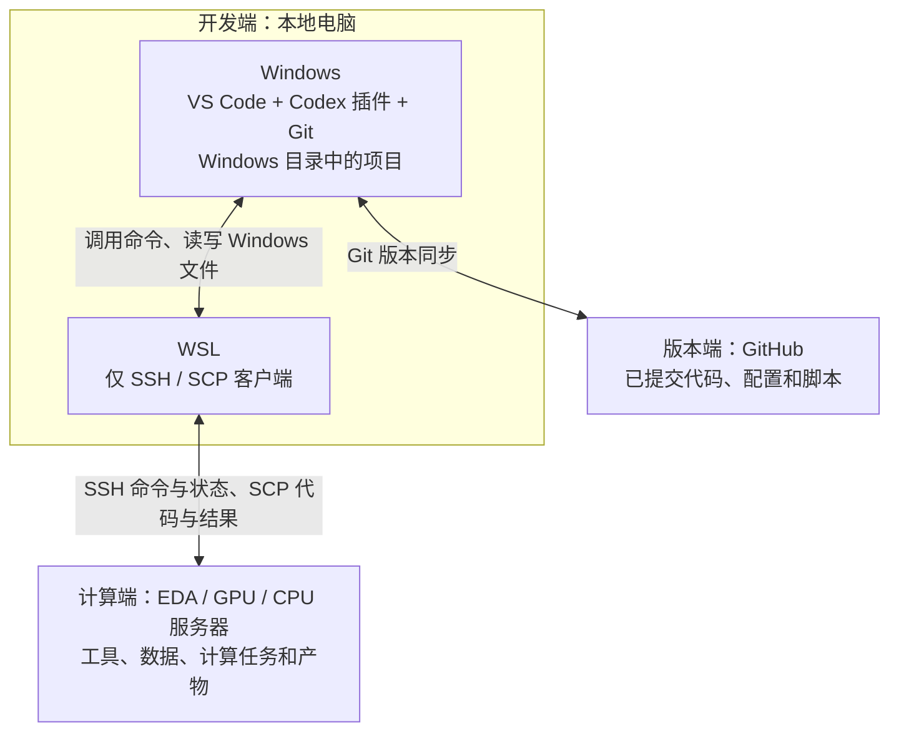

# 三端协作

> **云端存版本，本地做开发，远端跑计算。**
>
> 职责边界更新：2026-11-16。Windows 本地开发，Codex 作为 Windows 版 VS Code 的插件使用；WSL 仅用于 SSH 连接、SCP 文件传输与远程命令调用。实施进度见 [[三端协作实施清单]]。

## 为什么这样安排

科研任务需要不同服务器上的 EDA 工具、GPU 等资源，而代码编辑、智能体协作和差异检查放在 Windows 本地完成。Windows 版 VS Code 中的 Codex 插件协助修改代码；WSL 提供 SSH/SCP 客户端，用于上传代码、登录服务器、执行远程命令、查询任务状态与取回结果。具体计算任务由服务器运行。

## 各部分的职责

**“三端”指 GitHub 版本端、本地开发端和服务器计算端，不限定为三台机器。WSL 是本地电脑上的 SSH 入口。**

| 部分 | 主要职责 | 文件与运行位置 |
| --- | --- | --- |
| **Windows 版 VS Code + Codex 插件** | 编辑代码、审阅差异；由 Codex 插件协助编写代码和运行脚本。Git 提交、推送及需要的轻量本地验证也在 Windows 完成 | Windows 目录中的同一份 Git 仓库，例如 `D:\workspace_2027\项目名`；Codex 插件运行在 Windows 本地窗口中 |
| **GitHub** | 保存已提交的代码、配置和运行脚本，管理版本、分支和协作 | 已提交并推送的版本；不承担计算任务 |
| **WSL** | **仅通过 SSH/SCP 传输代码与结果、登录服务器、执行远程命令、提交任务和查询状态** | 保存 SSH 客户端配置、密钥和主机记录；通过 `/mnt/d/...` 直接读取 Windows 工作区，不另建开发副本、不运行本地 Python 样例 |
| **课题组计算服务器** | 按任务提供 EDA、GPU、CPU 等运行环境，执行计算、保存完整日志和产物 | 独立的代码快照、服务器工具与依赖、数据、任务输出 |

## 三端之间如何连接

### Windows 本地开发

- 在 **Windows 版 VS Code 的普通本地窗口**中直接打开 Windows 项目目录，以插件形式使用 Codex。编辑器、Codex 和 Windows Git 操作同一份代码。
- 本方案不通过 VS Code 的 WSL 扩展或 Remote - SSH 扩展打开开发工作区，也不在 WSL 中安装 VS Code Server、Codex 插件或 Codex CLI。
- 本地需要的小样例环境按项目需求在 Windows 配置；依赖服务器工具、许可证或 GPU 的验证在对应服务器执行。

### WSL 仅作为 SSH 连接与传输入口

- 在 WSL 的 `~/.ssh/config` 中记录计算服务器别名、地址、端口、登录用户、密钥和跳板机配置。
- 从 WSL 终端使用 `ssh` 登录和执行命令；Windows 终端或 Windows 中的 Codex 也可以调用 `wsl.exe -d Ubuntu -- ssh <服务器别名> <远程命令>`。其中远程命令实际在服务器执行。
- 文件传输使用 WSL 的 `scp`，从 `/mnt/d/workspace_2027/项目名` 读取 Windows 文件，回传结果也写回该 Windows 目录。SSH 与 SCP 复用同一份 WSL 服务器别名和认证配置。
- WSL 不保存日常开发仓库，不承担 Git 提交、本地 Python 测试、模型训练或 EDA 计算。服务器也不依赖 VS Code Server 或 Codex。

### 代码上传与结果回传

- **Windows 发起操作，WSL 的 SSH/SCP 负责传输**。代码始终保存在 Windows 工作区；上传指定快照，回收需要的小型结果文件，不在 WSL 建立第二份仓库。
- 上传前在 Windows 检查文件范围，使用新的独立运行目录；上传后通过 SSH 核对文件 SHA-256，再执行任务。回传后在 Windows 对照预期检查结果。
- Windows Git 使用 Windows 侧的 GitHub 认证；服务器连接使用 WSL 的 SSH 配置，两套认证用途不同。服务器地址、账号、密码、私钥与实际运行日志不进入代码仓库。
- GitHub 保存版本，代码快照通过 WSL 直接传给服务器；服务器无需直接访问 GitHub。此流程不需要安装 WSL 版 VS Code、Codex 或额外的同步工具。

## 多台服务器怎么分工

| 服务器类型 | 主要任务 |
| --- | --- |
| **EDA 服务器** | 使用专用 EDA 工具进行综合、仿真、布局布线等任务 |
| **GPU 服务器** | 模型训练、推理及其他 GPU 加速计算 |
| **其他服务器** | CPU 计算或其他专用任务，按需要扩展 |

**按任务选择服务器，只同步本次任务需要的代码、配置和脚本。** 各服务器的工作目录、数据位置和运行环境分别记录，不要求所有服务器的软件环境相同。

## 日常怎么用

1. **Windows 本地开发**：在 Windows 版 VS Code 中使用 Codex 插件修改代码、审阅差异，完成适合本地的小样例验证；依赖服务器环境的部分到对应服务器验证。
2. **保存版本**：用 Windows Git 提交并推送到 GitHub，从已提交版本生成固定代码快照，记录提交编号和文件校验清单。
3. **上传代码**：从 Windows 调用 WSL 的 SCP，把本次所需快照上传到目标服务器上新的独立运行目录。
4. **远程执行**：通过 WSL 的 SSH 连接核对远端文件、加载服务器环境并提交任务。有调度器的集群由调度器管理长任务；计算发生在服务器。
5. **查看结果并迭代**：通过 SSH 查询任务状态、退出码和结果摘要；通过 WSL 的 SCP 将需要的小型产物取回 Windows，在 Windows 检查结果是否符合预期。完整日志和大文件保留在服务器，代码修改回到 Windows 工作区完成。

## 当前试点

2026-11-16 已在 Windows 的 `D:\workspace_2027\wsl-demo` 完成一次“生成 Python 样例 → WSL SSH/SCP 上传到 EDA01 并执行 → 回传后在 Windows 对照预期 → 新建 GitHub 仓库并首次推送”的验证。

- 样例计算整数 1～10 的统计量：总和 55、平方和 385；完整结果与预期一致，本地与远端结果文件的 SHA-256 相同。
- Windows 使用 Python 3.12.14，EDA01 使用现有 Python 3.8.10；WSL 未运行 Python 样例，也未安装编辑器或 Codex。
- GitHub 私有仓库：[PKU-Zhou/wsl-demo](https://github.com/PKU-Zhou/wsl-demo)，首次提交 `4d53a7ca59097df6b35f9ab6b74d0ffb4d2b1454`。已从 GitHub 克隆回 Windows 并再次验证通过。
- 项目中的 `README.md` 和 `VERIFICATION.md` 保存通用流程与验证记录；本机具体命令见 `.local/本机复跑说明.md`。`.local/` 与 `results/` 被 Git 忽略，服务器密码不写入文件或 Git。

此次样例只验收代码传输与 Python 执行；真实 EDA 工具、许可证、GPU 和长任务调度仍需分别验证。

## 长期遵守的约定

- **Windows 工作区是日常修改入口。** 服务器上的临时修复通过提交或补丁带回 Windows；GitHub 是同一仓库的远端，不另建“提交专用副本”或 WSL 开发副本。
- **Codex 的使用位置固定。** Codex 作为 Windows 版 VS Code 的插件使用；需要远程操作时复用已验证、已获授权的 SSH/SCP 命令。WSL 的职责始终限于 SSH 连接、文件传输与远程命令调用。
- **正式实验可追溯。** 每次使用独立运行目录，排队和运行期间不覆盖源码；记录提交编号、目标服务器、参数、随机种子（如适用）、数据与环境版本、任务编号。未提交的修改不能只靠提交编号追溯。
- **源码与大文件分开。** 数据、日志、模型权重和运行产物不进入普通代码仓库；Git 忽略规则与上传文件清单分别检查，关键数据和结果另行备份。
- **GitHub 不作为运行的必经中转。** 默认由本地直接上传到目标服务器；GitHub 保存已提交且已推送的版本，不与每次本地编辑实时同步。

实施清单：[[三端协作实施清单|分阶段实施清单]]

> [!info]- 参考资料
> - [Codex：IDE 插件使用说明](https://learn.chatgpt.com/docs/codex/ide)
> - [Microsoft：Windows OpenSSH 与 SCP／SFTP](https://learn.microsoft.com/en-us/windows-server/administration/openssh/openssh-overview)
